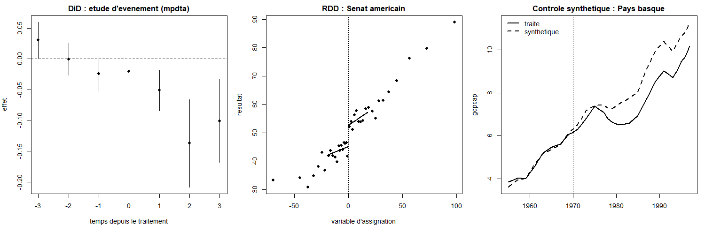

# mini-causal

Un petit package R d'inférence causale appliquée : différences de différences avec adoption échelonnée, discontinuité de régression et contrôle synthétique. Chaque méthode est testée sur un jeu de données public connu, et ses résultats sont comparés à ceux des implémentations de référence. Le point de départ est la partie sur l'évaluation de traitement de *Econometric Analysis* de Greene.



## Ce qu'il y a dedans

- **Différences de différences** (Callaway et Sant'Anna, 2021) : effets ATT(g, t) par cohorte et par date, estimateurs par régression, par pondération (IPW) ou doublement robuste, contrôles jamais traités ou pas encore traités, agrégations simple, dynamique, par cohorte et par date, écarts-types par fonction d'influence. Le DiD à effets fixes bi-directionnels est fourni pour la comparaison.
- **Discontinuité de régression** nette : polynôme local, correction du biais et variance robuste (Calonico, Cattaneo et Titiunik, 2014), fenêtre optimale pour l'erreur quadratique moyenne, tests de placebo et de manipulation
- **Contrôle synthétique** (Abadie et Gardeazabal, 2003) : poids par programmation quadratique, choix des poids des prédicteurs, placebos dans l'espace
- **Graphiques** : étude d'événement, discontinuité avec moyennes par classes, trajectoires du contrôle synthétique
- **Données publiques** dans `data/` : `mpdta` (salaire minimum et emploi, package `did`), `rdsenate` (Sénat américain, Lee 2008, package `rdrobust`) et `basque` (Pays basque, package `Synth`)

## Installation

Depuis la racine du projet, dans PowerShell :

```
Rscript.exe -e "install.packages(c('quadprog', 'testthat'), repos='https://cloud.r-project.org')"
R.exe CMD INSTALL .
Rscript.exe data/telecharger.R
```

Il faut R (version 4.x) et le package `quadprog`. `testthat` n'est utile que pour les tests. Le script de téléchargement installe, si nécessaire, `did`, `rdrobust` et `Synth`, puis récupère les jeux de données publics. Ces étapes nécessitent une connexion Internet. Lancez les scripts depuis la racine du projet, là où se trouvent `DESCRIPTION` et `exemple.R`.

## Exemple rapide

```r
library(minicausal)

mpdta <- read.csv("data/mpdta.csv")
res <- att_gt(mpdta, "lemp", "year", "countyreal", "first.treat", control_group = "nevertreated")
aggte(res, "dynamic")

senat <- read.csv("data/rdsenate.csv")
senat <- senat[!is.na(senat$vote), ]
rd_robust(senat$vote, senat$margin, 0)

basque <- read.csv("data/basque.csv")
dp <- synth_prep(basque, "regionno", "year", "gdpcap", 17, c(2:16, 18), traitement = 1970,
                 time_optimize = 1960:1969, predictors = c("school.illit", "invest"),
                 predictor_periods = 1964:1969)
synth(dp)
```

Cet exemple est une version courte. Pour le contrôle synthétique, `exemple.R` utilise plus de prédicteurs, donc les poids ci-dessous ne sortent pas de ces lignes.

`Rscript.exe exemple.R` fait tourner les trois méthodes et écrit `figures/resultats.png`. Le contrôle synthétique et ses 17 placebos prennent plusieurs secondes : le script affiche maintenant un message avant chacune de ces étapes pour qu'on sache qu'il travaille. Ce qu'on y voit :

- **DiD sur mpdta** : l'effet moyen simple est de -0.040 (écart-type 0.012) et l'effet dynamique de -0.077 (0.020), qui s'aggrave avec la durée d'exposition. Le DiD à effets fixes bi-directionnels donne -0.0365.
- **DiD simulé avec effets hétérogènes** (trois cohortes, effet qui croît avec l'exposition) : l'effet moyen vrai est de 2.47. Callaway-Sant'Anna donne 2.51 (écart-type 0.06), le DiD classique 0.89 (0.05). Il est donc fortement biaisé, ce qui illustre le problème des comparaisons avec des cohortes déjà traitées.
- **Sénat américain** : avec les fenêtres optimales (h = 17.75, b = 28.03), l'effet corrigé du biais est de 7.51 points de pourcentage de vote, avec un intervalle robuste à 95 % de [4.09, 10.92]. Avec une fenêtre moitié moindre, l'estimation monte à 13.0 (intervalle [7.4, 18.6]). Sur huit seuils fictifs, sept ne rejettent pas la nullité. Celui à -10 la rejette (p = 0.005), à garder en tête. Le test de manipulation ne détecte rien (49 observations contre 47 autour du seuil, p = 0.92).
- **Pays basque** : le contrôle synthétique est composé à 63.3 % de la Catalogne, 21.9 % des Baléares et 14.8 % de Madrid. L'écart moyen de PIB par habitant après 1970 est de -0.885, soit -9.9 % du niveau du contrôle. La p-value par placebos est de 0.353 : avec seulement 17 unités et des ajustements de placebos moins soignés, l'effet n'est pas significatif dans cette implémentation.

## Organisation

```
R/
    did.R       ATT(g, t), agrégations, DiD à effets fixes, étude d'événement
    rd.R        discontinuité, fenêtre optimale, placebos, graphique
    synth.R     préparation des données, poids, placebos, graphique
    utils.R     logit et écart-type d'influence
DESCRIPTION, NAMESPACE
data/           telecharger.R, puis les jeux de données publics (CSV)
tests/
    testthat/   helper.R et les tests (DiD, discontinuité, contrôle synthétique)
    references/ valeurs de référence et generer.R qui les produit
exemple.R
figures/
```

## Complexité

Notations : n unités, T dates, G cohortes, k covariables, I itérations du logit, c unités de contrôle, m prédicteurs, s départs de l'optimiseur de V, J itérations de Nelder-Mead.

| Méthode | Temps | Mémoire |
|---|---|---|
| ATT(g, t), une cellule | O(I n k² + k³) | O(n k) |
| ATT(g, t), toutes les cellules | O(G T I n k²) | O(n G T) |
| Agrégations et écarts-types | O(n G T) par agrégation | O(n G T) |
| Variance par plus proches voisins | O(n log n) pour le tri, puis O(n) | O(n) |
| Régression à noyau d'ordre p | O(n p²) | O(n p) |
| Fenêtre optimale | six évaluations de la variance, O(n) chacune | O(n) |
| Poids synthétiques, une résolution | O(c³) au pire (ensemble actif) | O(c²) |
| Choix des poids des prédicteurs | O(s J) résolutions | O(c²) |
| Placebos dans l'espace | c fois le choix des poids | O(c²) |

Les matrices de fonctions d'influence stockent une colonne par cellule, d'où la mémoire en n G T. L'exemple complet prend une dizaine de secondes, dont plus de 8 pour le contrôle synthétique et ses placebos (0.9 s pour l'estimation, 7.4 s pour les 17 placebos). Les différences de différences (0.01 s) et la discontinuité (0.05 s) sont instantanées.

## Validation

```
Rscript.exe -e "testthat::test_dir('tests/testthat', reporter='summary')"
```

Il y a 26 tests (12 pour les différences de différences, 8 pour la discontinuité, 6 pour le contrôle synthétique), qui fonctionnent avec ou sans le package installé. Les valeurs de référence viennent des packages R d'origine (`did`, `rdrobust`, `Synth`) et se génèrent avec `Rscript.exe tests/references/generer.R` après `Rscript.exe data/telecharger.R`. Les tests de comparaison sont ignorés si les fichiers de référence sont absents.

**Différences de différences** : huit configurations sont comparées à `did` (régression, IPW et doublement robuste, avec ou sans covariable, contrôles jamais traités ou pas encore traités, période de base variable ou universelle). Les ATT(g, t) sont comparés à 1e-8 près, les écarts-types à 1e-6 et les quatre agrégations (simple, dynamique, par cohorte, par date) à 1e-7 environ. Par simulation, Callaway-Sant'Anna retrouve les effets vrais alors que le DiD classique est biaisé, les cellules avant traitement sont proches de zéro, et le cas 2x2 redonne la différence de différences de moyennes.

**Discontinuité** : estimation classique et corrigée du biais, écarts-types classique et robuste et effectifs sont comparés à `rdrobust` pour quatre couples de fenêtres, et la fenêtre optimale est comparée à celle de `rdbwselect` (17.7544 et 28.0281). Par simulation, l'intervalle robuste couvre le vrai saut dans 90 à 99.5 % des cas sur 150 échantillons, la correction de biais réduit bien le biais quand la courbure est forte, et les tests de placebo et de manipulation se comportent comme attendu.

**Contrôle synthétique** : les matrices de prédicteurs sont comparées à celles de `Synth`. Avec la même matrice V, les poids sont comparés à ceux de `Synth` et vérifient les conditions de Kuhn-Tucker du programme quadratique. Mon choix de V doit trouver une perte avant traitement au plus 5 % au-dessus de celle de `Synth`. Sur un modèle à facteurs simulé, l'effet vrai est retrouvé, et les placebos donnent une p-value basse avec un effet et élevée sans effet.

## Limites

- **DiD** : panels équilibrés seulement, pas de poids, d'anticipation, de clusters ni de bootstrap. Les écarts-types sont analytiques (fonction d'influence), sans bandes de confiance uniformes.
- **Discontinuité** : régression nette uniquement, sans covariables, sans clusters et avec la seule variance par plus proches voisins. La fenêtre est de type "mserd", avec le nombre de valeurs distinctes de la variable d'assignation pour les points de masse.
- **Contrôle synthétique** : l'optimisation des poids V par Nelder-Mead peut s'arrêter dans un minimum local, c'est pourquoi j'essaie plusieurs départs (le choix de V peut donc différer légèrement de celui de `Synth`). Quand il y a moins de prédicteurs que de contrôles, le programme quadratique n'est pas strictement convexe, et j'ajoute une très petite constante sur la diagonale. Les placebos utilisent moins de départs que l'estimation principale, ce qui peut gonfler leur perte avant traitement.

## Références

Articles : Callaway et Sant'Anna (2021) pour les différences de différences avec adoption échelonnée, Sant'Anna et Zhao (2020) pour l'estimateur doublement robuste, Goodman-Bacon (2021) pour le biais du DiD à effets fixes. Calonico, Cattaneo et Titiunik (2014) pour la discontinuité robuste, Lee (2008) pour les données du Sénat. Abadie et Gardeazabal (2003) et Abadie, Diamond et Hainmueller (2010) pour le contrôle synthétique. Greene, *Econometric Analysis* (8e édition) : les parties sur l'évaluation de traitement et les données de panel.

Packages dont je me suis inspiré et qui servent de référence pour les tests :

- `did` (R) : https://bcallaway11.github.io/did/
- `rdrobust` (R) : https://rdpackages.github.io/rdrobust/
- `Synth` (R) : https://cran.r-project.org/package=Synth
